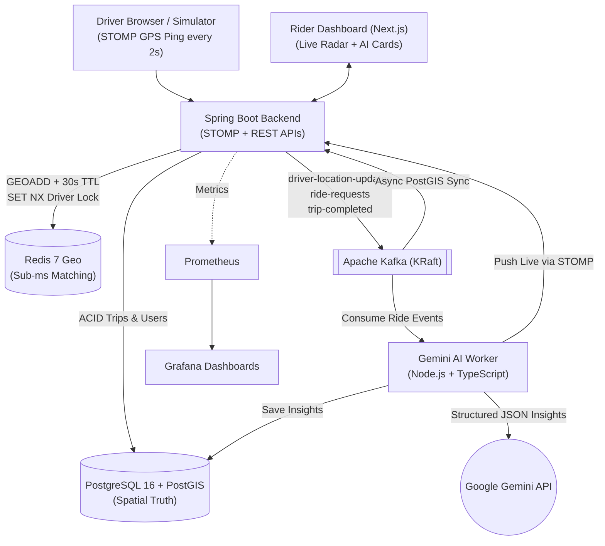

# NeuroRide — AI-Powered Real-Time Ride-Hailing Platform

I built **NeuroRide** to understand and demonstrate how modern, high-throughput ride-hailing platforms (like Uber or Ola/Lyft) work under the hood—combining **sub-millisecond driver matching**, **live GPS streaming**, **event-driven microservices**, **real-time AI insights**, and **production observability** in one reproducible project.

> **New to distributed systems?** No worries. Every piece of the architecture is explained in plain English below, and you can spin up the entire platform on your own machine using Docker.

---

## Screenshots

### Real-Time Dispatch & Geospatial Radar (`http://localhost:3000`)


### Containerized Microservices Stack (Docker Desktop)


---

## How NeuroRide Works (Plain-English Architecture)

Think of a ride-hailing app as five specialized teams working together in real time:

1. **The Walkie-Talkie (`Next.js` + `Spring Boot WebSockets/STOMP`):**
   Instead of refreshing the page every second, the rider and driver keep a live two-way connection open. Every 2 seconds, the driver broadcasts their GPS coordinates.
2. **The Fast Whiteboard (`Redis Geo`):**
   Writing thousands of GPS pings per second directly to a hard-drive database would slow everything down. Instead, Redis holds active driver coordinates in memory so finding drivers within 5 km takes **less than a millisecond**. It also uses a short-lived **distributed lock (`SET NX`)** so two riders can never accidentally book the exact same driver simultaneously.
3. **The Permanent Ledger (`PostgreSQL + PostGIS`):**
   While Redis handles fast live radar, PostgreSQL with the **PostGIS** spatial extension stores the permanent source of truth—users, vehicles, trip history, fares, and AI insights.
4. **The Conveyor Belt (`Apache Kafka`):**
   When a ride is requested or completed, the backend places an event onto Kafka (`driver-location-updates`, `ride-requests`, `trip-completed`). This decouples heavy background work from the core booking API so riders never wait on slow external tasks.
5. **The AI Co-Pilot (`Gemini 2.5 Flash` Worker):**
   A separate Node.js/TypeScript microservice listens to Kafka events and calls Google's Gemini API to generate transparent **surge explanations**, **safety/pickup tips**, and **post-trip summaries**, then pushes them live back to the rider's screen over WebSockets. *(Includes a deterministic fallback if no API key is configured.)*



---

## Tech Stack

| Layer | Technology | Why I Chose It |
| :--- | :--- | :--- |
| **Frontend** | Next.js 15 (App Router), Tailwind CSS, `@stomp/stompjs` | Live geospatial radar UI + real-time WebSocket subscriptions |
| **Core Backend** | Java 21, Spring Boot 3.3, Spring Data JPA, Hibernate Spatial | High-concurrency REST APIs, STOMP broker, and strict schema validation |
| **Hot Cache & Geo** | Redis 7 (`GEOADD`, `GEOSEARCH`, `SET NX` locks) | Sub-millisecond nearby driver lookup & double-booking prevention |
| **Database** | PostgreSQL 16 + PostGIS (`GEOGRAPHY(Point, 4326)`) | Durable ACID transactions and spherical Earth distance queries |
| **Event Streaming** | Apache Kafka 3.8 (KRaft mode, no ZooKeeper) | Asynchronous decoupling between trip dispatch and AI/DB sync |
| **AI Microservice** | Node.js 22, TypeScript, `@google/genai` | Structured JSON outputs from Gemini 2.5 Flash |
| **Observability** | Prometheus, Grafana (auto-provisioned), Sentry | Live p95 latency, match-rate metrics, and error tracking |
| **Load Testing & CI** | k6, Docker Compose, GitHub Actions | Automated builds, SLA verification (`p95 < 250ms`), and GHCR image builds |

---

## Quick Start (Anyone Can Run This in ~5 Minutes)

### Prerequisites
- **[Docker Desktop](https://www.docker.com/products/docker-desktop/)** installed and **running** *(on Windows, ensure the WSL 2 backend is enabled)*.
- *(Optional)* A free **[Google Gemini API Key](https://aistudio.google.com/)** — if left blank, the AI service uses its built-in fallback so everything still works end-to-end.

### Step 1: Clone & Create `.env`
**macOS / Linux / WSL Bash:**
```bash
git clone https://github.com/<your-username>/neuroride.git
cd neuroride
cp .env.example .env
```

**Windows PowerShell:**
```powershell
git clone https://github.com/<your-username>/neuroride.git
cd neuroride
Copy-Item .env.example .env
```
*(Optional: open `.env` and add `GEMINI_API_KEY=your_key_here`.)*

### Step 2: Build & Start All 8 Containers
Make sure you run this from the **root `neuroride/` directory** (where `docker-compose.yml` lives):
```bash
docker compose -f docker-compose.yml -f docker-compose.app.yml up -d --build
```
*(The very first build takes ~5 minutes to download Maven and npm dependencies. Restarts after that take ~15 seconds.)*

### Step 3: Verify Health
Wait ~20 seconds for Spring Boot to finish starting, then check:
```bash
docker compose -f docker-compose.yml -f docker-compose.app.yml ps
```
**Bash (macOS/Linux/WSL):**
```bash
curl -s http://localhost:8080/actuator/health
```
**Windows PowerShell:**
```powershell
curl.exe http://localhost:8080/actuator/health
```
Expected response: `{"status":"UP"}`

---

## Live Demo Walkthrough

Open **`http://localhost:3000`** in your browser:

1. **Verify WebSocket Connection:** The top-right badge turns green: **`STOMP Connected`**.
2. **Simulate a Driver First:** Click **`Simulate Online Driver`**. The app begins broadcasting GPS pings every 2 seconds over WebSocket → Spring Boot → Redis Geo & Kafka.
3. **Scan Redis Geo:** Click **`Scan Redis Geo`** to query available drivers within 5 km—you will see **`1 drivers in 5km radius`** and a yellow driver dot on the radar.
4. **Request a Ride:** Click **`Request Ride`**. Spring Boot locks the driver in Redis (`SET NX`), saves the ride in PostGIS, and publishes a `ride-requests` event to Kafka.
5. **Start & Complete the Trip:** Click **`Start Trip`** to watch the blue **`DRIVER (LIVE)`** marker move across the radar in real time, then click **`Complete Trip`** to emit `trip-completed` to Kafka and stream the **Gemini AI Insights** card onto the right panel.

---

## Observability & Load Testing

- **Grafana Dashboards:** `http://localhost:3001`  
  Login: `admin` / `neuroride_grafana` → **Dashboards → NeuroRide → NeuroRide Distributed Platform**
- **Prometheus Targets:** `http://localhost:9090/targets` *(confirm `neuroride-backend` and `neuroride-ai-service` are `UP`)*
- **Run k6 Load Test (via Docker, no local install required):**

  **Bash (macOS/Linux/WSL):**
  ```bash
  docker run --rm -i --network neuroride-infra_neuroride-net \
    -e API_URL=http://backend:8080/api/v1 \
    grafana/k6 run - < load-tests/neuroride-load.js
  ```

  **Windows PowerShell:**
  ```powershell
  Get-Content load-tests\neuroride-load.js -Raw | docker run --rm -i --network neuroride-infra_neuroride-net `
    -e API_URL=http://backend:8080/api/v1 `
    grafana/k6 run -
  ```
  Keep Grafana open on `http://localhost:3001` while running k6 to watch p95 latency and request-rate graphs spike live.

---

## Real Errors I Hit & What I Learned Building This

Tutorials usually hide the messy debugging steps. Here are the real issues I ran into while building and running NeuroRide locally, and how I fixed them:

1. **Docker's "Empty Folder Trap" (`neuroride-postgres` failed as unhealthy)**
   - **What happened:** When `docker-compose.yml` tried to mount `./infra/postgres/init.sql` before the file existed in the right spot (or while `.sql` files were nested inside a subfolder named `init.sql`), Docker automatically created an **empty directory** instead of a file. Postgres failed to initialize and exited immediately.
   - **What I learned:** Always verify bind-mounted config/SQL paths are actual files (`01-init.sql`, `02-seed.sql`) before running `docker compose up`.

2. **"Skipping Initialization" & Hibernate `ddl-auto: validate` (`Empty reply from server` on `:8080`)**
   - **What happened:** Even after fixing the SQL path, `curl http://localhost:8080/actuator/health` returned `Empty reply from server`. Checking `docker logs neuroride-postgres` revealed: *"PostgreSQL Database directory appears to contain a database; Skipping initialization"*. Because an earlier failed run left an empty `pg_data` volume behind, Postgres skipped creating the tables, causing Spring Boot (`ddl-auto: validate`) to fail startup.
   - **What I learned:** Never rely only on `docker compose ps`—check container logs and inspect the schema (`psql -c "\dt"`). When updating DB init scripts, wipe volumes with `docker compose ... down -v` or pipe the SQL directly into `psql`.

3. **Windows Terminal Context (`PowerShell` vs `WSL/Bash` + `PATH` Caching)**
   - **What happened:** Running Linux commands like `uname -a` failed in VS Code's default Windows PowerShell, running `docker compose` from inside `backend/` failed because `docker-compose.yml` lives in the project root, and VS Code needed a restart after installing Docker Desktop to pick up the updated `PATH`.
   - **What I learned:** Always check both your active shell (`PowerShell` vs `WSL Bash`) and working directory before running orchestration commands.

4. **VS Code Showing "162 Problems" Before Local `npm install`**
   - **What happened:** Even though `docker compose up --build` compiled `frontend` and `ai-service` cleanly inside Docker, VS Code showed 162 TypeScript squiggles in the editor.
   - **What I learned:** Docker builds use isolated container `node_modules`, whereas VS Code's TypeScript IntelliSense reads local `node_modules/`. Running `npm install` locally inside `frontend/` and `ai-service/` clears all editor errors immediately.

5. **WebSocket Subscription Race Conditions & Async AI**
   - **What happened:** Calling an LLM synchronously inside a booking endpoint would destroy API p95 latency, so I offloaded Gemini calls to Kafka. I also observed that if the AI worker processes `ride-requests` faster (~10ms) than the frontend finishes subscribing to `/topic/ride.{rideId}.insights`, an instant WebSocket push can arrive before the client subscribes—showing why storing insights in PostgreSQL (`GET /api/v1/rides/{rideId}/insights`) alongside WebSocket pushes is critical.

---

## Useful Commands Cheat Sheet

```bash
# Check status of all containers
docker compose -f docker-compose.yml -f docker-compose.app.yml ps

# Tail logs for backend and AI worker
docker compose -f docker-compose.yml -f docker-compose.app.yml logs -f backend ai-service

# Inspect live Redis Geo driver pool
docker exec -it neuroride-redis redis-cli -a neuroride_redis_secret ZRANGE drivers:geo:active 0 -1 WITHSCORES

# Inspect rides & AI insights in PostgreSQL
docker exec -it neuroride-postgres psql -U neuroride_admin -d neuroride -c "SELECT id, status, surge_multiplier, estimated_fare_usd FROM rides ORDER BY requested_at DESC LIMIT 5;"
docker exec -it neuroride-postgres psql -U neuroride_admin -d neuroride -c "SELECT ride_id, insight_type, model_version, left(summary_text, 60) FROM ride_ai_insights ORDER BY created_at DESC LIMIT 5;"

# Stream live Kafka events
docker exec -it neuroride-kafka /opt/kafka/bin/kafka-console-consumer.sh --bootstrap-server localhost:9092 --topic ride-requests --from-beginning

# Stop containers (preserve database/Grafana volumes)
docker compose -f docker-compose.yml -f docker-compose.app.yml down

# Full clean reset (wipe all volumes)
docker compose -f docker-compose.yml -f docker-compose.app.yml down -v
```